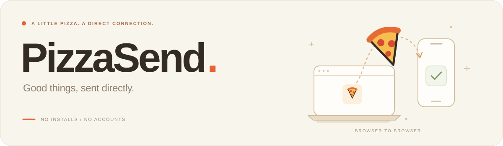

   &nbsp; English

  
  <h3>Fresh files. Straight to you.</h3>
  
No installs. No accounts. Open a page and send files to another device.

  

  
WebRTC · DTLS · SHA-256 · Open source

## Good things, sent directly

PizzaSend is an open-source file transfer tool for your browser. Move photos, videos and documents between a phone and a computer, or share the same files with friends. A link or QR code connects you, without uploading to cloud storage first.

<table width="100%">
  <thead><tr><th align="left">Feature</th><th align="left">What you get</th></tr></thead>
  <tbody>
    <tr><td><strong>Direct</strong></td><td>DTLS over WebRTC. Files stay off the pairing server.</td></tr>
    <tr><td><strong>Original</strong></td><td>Names and bytes stay intact, checked with SHA-256.</td></tr>
    <tr><td><strong>Together</strong></td><td>One link, up to 10 people, each with their own progress.</td></tr>
  </tbody>
</table>

Share files. Drop a folder on a computer to package it as a ZIP. Pair by QR. Recover after network changes. On slow links, compression is suggested when it should save time.

## Three steps

1. **Pick your files.** Click to choose files, or drop a folder on a computer. Folders become ZIPs; extract them after receiving.
2. **Pass it on.** Send the link or let the other person scan the QR code.
3. **Save to the device.** They accept the transfer, then follow the save prompt.

## Behind the transfer

- **Lightweight pairing, direct delivery.** Cloudflare helps peers connect, with connection information encrypted in the browser using AES-256-GCM. Files travel over a WebRTC DataChannel protected by DTLS, without being stored on a server.
- **Write as you receive.** Browsers with disk support save chunks and verify them with incremental SHA-256, reducing memory pressure for large files. Receivers prefer WebAssembly for hashing, with an automatic JavaScript fallback.
- **Adapt to the connection.** Receiver feedback adjusts the sending window; automatic pairing can resume from confirmed progress after a disconnect. Slow-link compression estimates include compression and decompression time. It is offered only when worthwhile and restores the original files on receipt.

## Before you send

- **Keep both pages open.** Automatic pairing can reconnect; refreshing or closing loses unfinished transfers. Phone locking may interrupt them.
- **Save what you receive.** Browser copies have a ten-minute expiry and may be reclaimed sooner. Your downloaded copies stay.
- **Size depends on the receiver.** Space and browser quota set the limit. Without disk storage, total reception is capped at 256 MiB.
- **Direct first, relay as fallback.** Cloudflare TURN is tried if connecting fails, or speed stays low with a long ETA. DTLS still encrypts files; the relay does not store them. Restricted networks may still block connections. Links grant access: share them only with people you trust.

## A little more

[Develop & deploy](docs/development.en.md) &nbsp; · &nbsp; [Security design](docs/security-hardening.md) &nbsp; · &nbsp; [Engineering notes](docs/README.md) &nbsp; · &nbsp; [MIT License](LICENSE)

Most engineering notes are in Chinese.

---

Inspired by <a href="https://github.com/kern/filepizza">FilePizza</a>. Independently built. A little pizza spirit. A direct connection.

